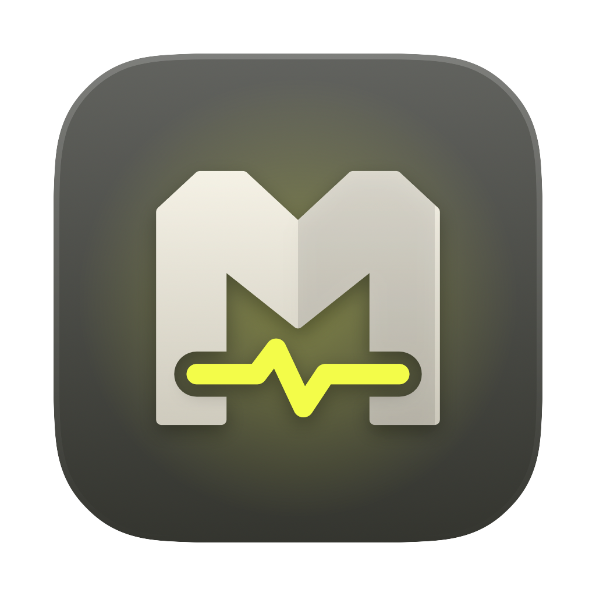

<p align="center">
  
</p>

<h1 align="center">MacHealth</h1>

<p align="center">macOS için Türkçe bakım ve sağlık uygulaması: gereksiz dosyaları bulur, <b>önce gösterir</b>, onayınla Çöp Kutusu'na taşır.</p>

---

## Özellikler

- **Ana Sayfa** – tek tuşla tüm modülleri tarar; disk ve RAM özeti
- **Sistem Çöpü** – önbellekler, loglar, geçici dosyalar, Xcode ve geliştirici artıkları, tarayıcı önbellekleri
- **Büyük Dosyalar / Kopya Dosyalar / Klasörler** – yer kaplayan, birebir aynı ve boş klasörleri bulur
- **Uygulamalar** – uygulamayı artıklarıyla kaldırır, sıfırlar; "gereksiz olabilir / ara sıra / gerekli" kategorileri; silinmiş uygulamalardan kalan sahipsiz dosyalar
- **Mac Sağlığı** – pil sağlığı ve geçmişi, güvenlik kontrolleri, tek tıkla optimize
- **Hızlandır / Bellek** – başlangıç öğeleri, arka plan servisleri, bellek kullanımı
- **Disk Haritası** – klasörleri kutu haritası (treemap) olarak gezme; bilinen klasörler için "bu nedir, silersen ne olur?" bilgisi
- **Geçmiş** – her temizlik kaydedilir, tek tuşla geri alınabilir
- **Menü çubuğu** – disk/RAM durumu, disk dolunca uyarı

Silinen her şey önce **Çöp Kutusu'na** gider; korunan sistem yolları hiçbir zaman silinmez. Her işlem `~/Library/Logs/MacHealth/machealth.log` dosyasına yazılır.

## Kurulum

[Releases](../../releases) sayfasından `MacHealth-x.y.z.dmg` dosyasını indir, açıp **MacHealth**'i **Uygulamalar** klasörüne sürükle.

> Uygulama Apple tarafından onaylanmış (notarize) değildir. İlk açılışta macOS uyarı verirse: sağ tık › **Aç**, ya da
> Sistem Ayarları › Gizlilik ve Güvenlik › **Yine de Aç**.

Gereksinim: macOS 14 (Sonoma) veya üstü, Apple Silicon.

## İzinler

Uygulama verilerini (`~/Library/Containers`) tarayabilmek için **Tam Disk Erişimi** gerekir. Bu izin olmadan macOS her uygulamanın klasörü için
ayrı ayrı izin sorardı; MacHealth bu yüzden izin verilene kadar o klasörlere hiç girmez.

**Ayarlar › İzinler › İzin ver**: Sistem Ayarları'nda doğru sayfa açılır ve MacHealth Finder'da seçili gelir; anahtarı açman yeterli.

## Kaynaktan derleme

Yalnızca Xcode Command Line Tools yeterlidir (Swift 6).

```sh
./scripts/setup-signing.sh   # tek seferlik: kalıcı yerel imza sertifikası (izinler derlemeler arasında korunur)
./scripts/build-app.sh       # build/MacHealth.app
./scripts/make-dmg.sh        # build/MacHealth-<sürüm>.dmg
```

Geliştirici araçları:

```sh
swift build
.build/debug/MacHealth --report                      # tarama sonuçlarını yazdırır (hiçbir şey silmez)
.build/debug/MacHealth --snapshot <klasör> [modül]   # ekranları PNG olarak çizer
.build/debug/MacHealth --render-logo logo.png 1024   # logoyu PNG olarak üretir
```
